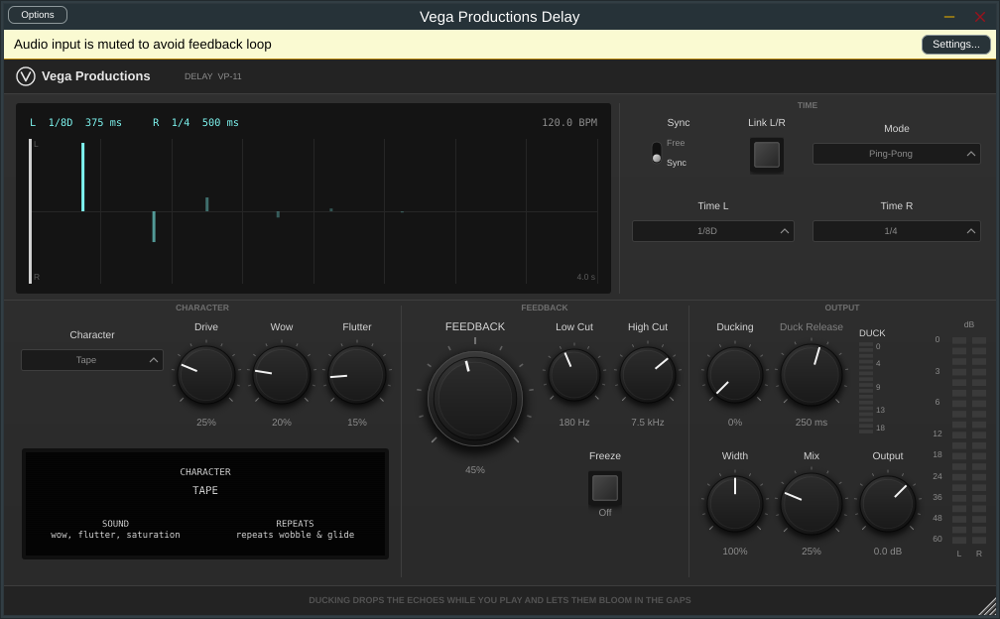

# Vega Productions Delay (VP-11)

Tempo-synced tape / analog / digital delay for the Vega Productions suite.



## Download
- **Windows (FL Studio):** https://github.com/DJVega70/vega-delay/releases/latest/download/VegaProductions-Delay-Windows-VST3.zip
- **macOS:** https://github.com/DJVega70/vega-delay/releases/latest/download/VegaProductions-Delay-macOS-VST3-AU.zip

## Features
- **Sync or free time:** 1/32 to 1 bar incl. dotted and triplet values, separate L/R times (or linked); free mode in ms with TAP tempo.
- **Modes:** Stereo, Ping-Pong (repeats bounce L ↔ R), Mono.
- **Characters:** Digital (clean), Analog (bucket-brigade warmth), Tape (wow, flutter, asymmetric saturation, pitch-gliding time changes), Lo-Fi (crushed, band-limited).
- **Feedback path:** Low Cut / High Cut filters and Drive inside the loop, so every repeat gets darker and grittier — stable even at 100%.
- **Ducking:** echoes dip while you play and bloom in the gaps (classic vocal/lead delay trick) with adjustable release.
- **Freeze:** hold the current echoes as an infinite loop.
- Width (0–200%), Mix, Output, echo map display showing exactly where each repeat lands. Resizable.

## Building
```
cmake -B build -DVEGA_TESTS=ON
cmake --build build --config Release --target VegaDelay_VST3 VegaDelayTest
```
